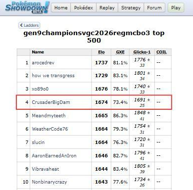
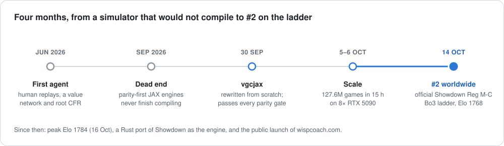
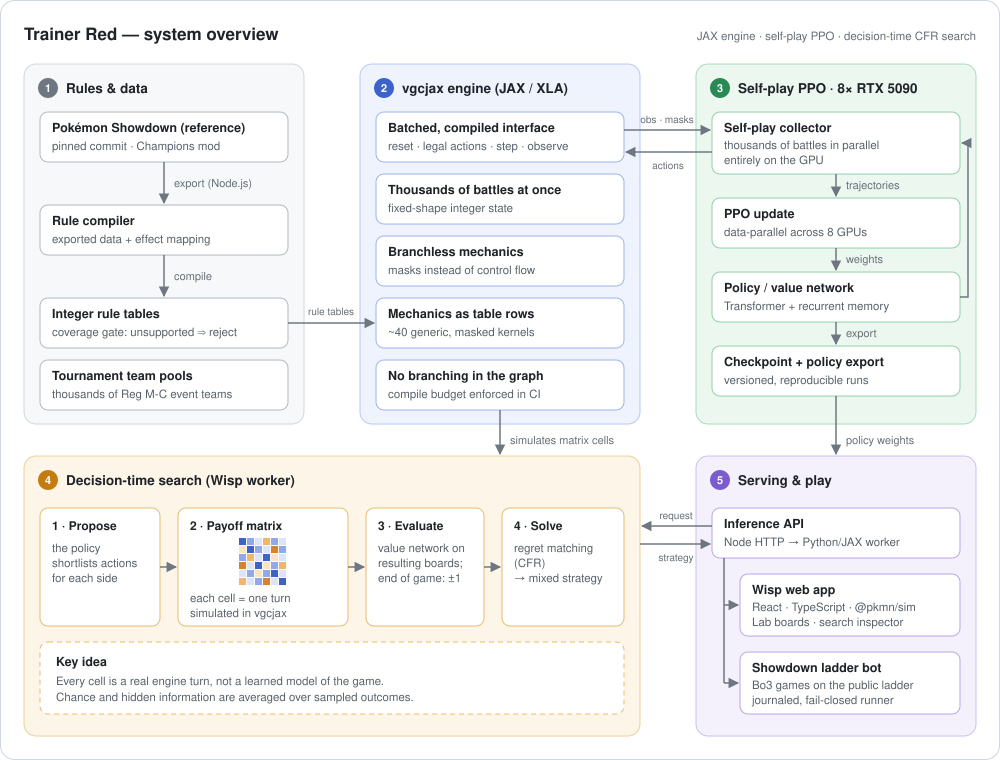
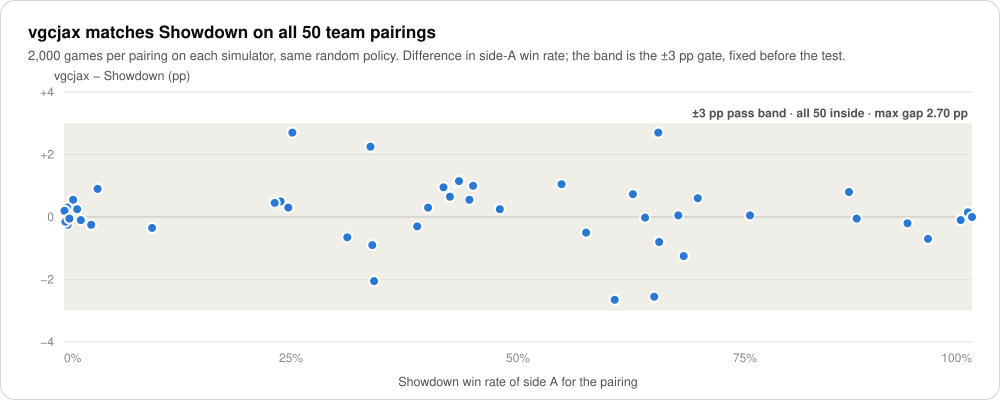
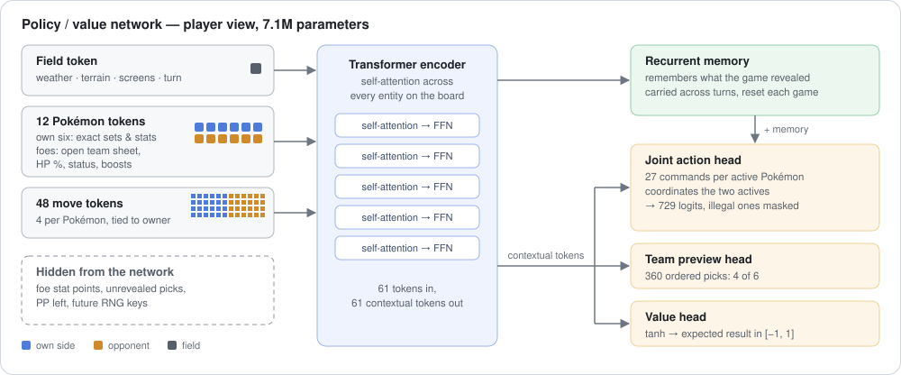

# Trainer Red

**An AI that taught itself competitive Pokémon doubles and reached #4 on the global ladder.**

  
   
  Official Showdown ladder, Champions VGC Reg M-C best of three, 12 October 2026. The bot plays as <i>CrusaderBigDam</i>: peak Elo 1674, GXE 73.4%.

VGC doubles is a hard game for an AI. Both players move at the same time, each turn offers up to 729 joint actions per side, the opponent's stats are hidden and every hit rolls dice. This is how a two-person side project went from zero to #4 on the global ladder in four months. *The source code is private; this write-up covers the ideas and the results.*

---

### 1. Making the game fast

Learning by self-play takes hundreds of millions of games, and the reference simulator, Pokémon Showdown, runs one battle at a time. The first attempt ported it to JAX event by event. It needed over a thousand nested branches and **never finished compiling**, even with 128 GB of RAM.

So the engine, **vgcjax**, was rewritten from scratch around what GPUs are good at. There is no branching in the game logic: every rule is masked array arithmetic, so thousands of battles advance in lockstep. Moves, abilities and items are rows of data, not code paths. A compile budget in CI rejects any change that makes the program too large. The result compiles in **27 seconds** and runs **7.55 million games per hour on a single consumer GPU**.

### 2. Making it correct

Speed is useless if the simulator plays a different game. vgcjax does not copy Showdown's random sequence, so it is checked statistically instead. Across 50 team pairings with 2,000 games each on both simulators, **every win rate lands within ±3 points** of Showdown's. **319,990 of 320,000 damage rolls** match exactly. A 10,000-game fuzz found zero invalid states. The thresholds were fixed before the tests and never moved.

### 3. Teaching it to play

A **~7M-parameter Transformer** reads the board as 61 tokens (the field, twelve Pokémon and their moves) and keeps a recurrent memory of what the game has revealed. It sees exactly what a human player would see. Its action head scores all 729 joint actions together, so the two Pokémon on the field learn to coordinate. It was trained with **PPO through self-play on 8× RTX 5090**: 127.6 million games in a single 15-hour run, and **more than 450 million** across all training generations.

### 4. Thinking at play time

On the ladder the network does not play alone. At every decision it shortlists promising actions for both players. The engine simulates each pairing, averaging over dice and over the opponent's hidden stats, and the network's value head scores the outcomes. The turn is then solved as a matrix game with **counterfactual regret minimisation (CFR)**. The move is drawn from the resulting mixed strategy, so the bot is hard to predict.

### 5. Putting it on the ladder

A Node.js client turns Showdown's live battle protocol into the engine's view of the game. It plays ranked best-of-three series against humans, logs every decision so it can be replayed, and stops on any fault. The latest campaign won **62 of 106 series**, and on 12 October 2026 the account peaked at **#4 worldwide**. A companion React web app lets a player face the bot and inspect the payoff matrix behind each of its moves.

---

**My role.** I led the simulator (design, most mechanics, validation) and built the search, the web app and the ladder bot. My collaborator built the first training pipeline; since October I have led the later training generations, the evaluation and the ladder campaigns.

JAX · XLA · Python · CUDA · multi-GPU training · Node.js · TypeScript · React · Docker — Pokémon is a trademark of Nintendo, Creatures Inc. and GAME FREAK inc.; independent project.

[← Back to my GitHub profile](https://github.com/alemoscardo)
